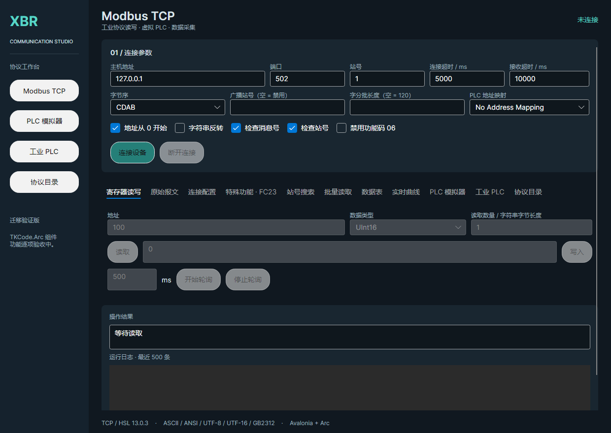

# XBR Communication Studio

基于 [dathlin/HslCommunication](https://github.com/dathlin/HslCommunication) Demo 的 Avalonia 桌面界面重构项目。显示名：**XBR 通信工作台**。

保留上游 WinForms 示例和提交历史，新界面采用 **Avalonia 12.1.6 + TKCode.Arc 1.1.0 + CommunityToolkit.Mvvm + .NET 10**。



## 当前功能

- Modbus TCP 连接、站号、字节序、超时、广播与分批参数。
- 类型化读写、原始报文、只读轮询、有限日志、单设备明文 XML 配置。
- FC23 读写寄存器，Word/Bool 站号搜索、匹配即停和取消。
- 批量读写的 12 种显示/写入格式、按字反转、每行数量和缓存重解析。
- 官方同构批量解析子表、正则/文本查找定位和 C# 解析代码示例。
- 官方 `DataTableItem` XML、混合标量/数组/表达式、失败行继续、六种字符串编码和 CSV 历史。
- 数据表当前值双击写入并回读；Arc 多曲线颜色、虚线、平滑/直线、线宽和时间窗。
- 15 项监控集成、23 项协议矩阵和 10 连接 × 20 点位 × 500ms 压力探针通过。
- 内置 Modbus 模拟服务端、12 个地址映射选项、表达式模拟写入和官方 `SimulateWrite` XML 导入导出。
- 三菱 MC 3E Binary、西门子 S7-1200、欧姆龙 FINS TCP 客户端与原生模拟服务端：基础类型/数组读写、服务端本地内存、数据池保存恢复。
- 协议目录检索和页面导航；新增模拟服务端闭环 61 项测试通过。官方相关功能窗体清单共 189 个，见 [迁移清单](docs/PLC-MIGRATION.md)。

**迁移进行中，尚未实现原版全部页面和功能，也未完成真机验收。**

## 运行

Windows、.NET 10 SDK。请从自己的原版安装/发布包准备 **HslCommunication.dll 13.0.3** 和 Newtonsoft.Json.dll；不在本分支新增分发这些依赖或授权信息。

```powershell
.\tools\Set-HslReferences.ps1 -SourceDirectory '你的原版发布包目录'
dotnet run --project src/Xbr.Desktop
```

也可通过 `-p:HslReferenceDirectory=依赖目录` 指定位置。

```powershell
dotnet build probes/LegacyModbus
dotnet run --project probes/ModbusMatrix
dotnet run --project probes/MonitoringIntegration
dotnet run --project probes/ServerSimulationIntegration
dotnet run --project probes/MonitoringSoak -- 10 10 20 500
dotnet run --project probes/DesktopSmoke
```

LegacyModbus 使用 Windows .NET Framework 4.8.1；比较旧 DLL 的 API 分支与现代服务，不是原版 EXE 按钮自动化。矩阵测试只访问本机模拟器。

## 目录

| 目录 | 用途 |
|---|---|
| src/Xbr.Desktop | Avalonia + Arc 界面及 MVVM |
| src/Xbr.Communication | 连接、排队读写、搜索与配置服务 |
| probes | 兼容性、Framework 对照、服务及渲染检查 |
| HslCommunicationDemo | 保留的官方 WinForms 示例 |
| docs | 来源、迁移边界、验收场景及证据 |

## 来源与授权

上游版权及授权说明保留在 [README.upstream.md](README.upstream.md)。上游 README 列明 Richard.Hu 版权和 HSL 授权方式；本 Fork 不将通信库改名为自有协议库、不更改授权逻辑，也不为整个项目重新授予 MIT 许可证。

TKCode.Arc 的 MIT 许可及 notices 位于 [docs/third-party](docs/third-party)。详细源码映射、13.0.0/13.0.3 版本差异和验收范围见 [docs/UPSTREAM.md](docs/UPSTREAM.md)。此前本地反编译目录未加入本分支。

## 下一步

以原版虚拟 PLC 服务端作为无实物验收基线，继续补 MC/S7/FINS 专用参数、批量/点表/曲线和模拟写入；随后迁移 ABB/FANUC/KUKA 等机械手专用读写页面。按原版调用、默认参数、返回值和报文逐项对照，不将目录入口计为功能完成。
